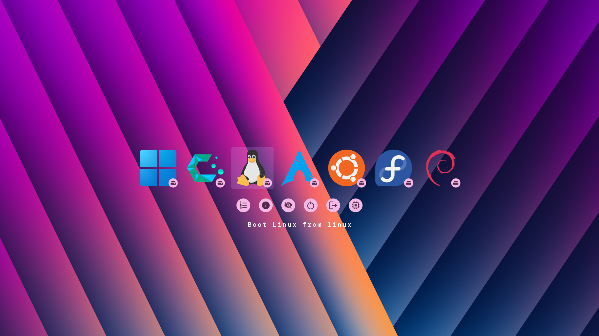

# Rectilinear

## A minimal rEFInd theme: Material 3 Expressive colours derived from the wallpaper, glass highlights, Geist Mono

### Usage

1.  Locate your refind EFI directory. This is commonly `/boot/EFI/refind`
    though it will depend on where you mount your ESP and where rEFInd is
    installed.

2.  Create a folder called `themes` inside it, if it doesn't already exist

3.  Clone this repository and place `rectilinear` subfolder into the `themes` directory.

4.  The `utils` folder regenerates every generated asset, including `preview.png`:
    run `utils/build.sh` after editing `utils/tokens.sh` (colours, shapes, sizes), the glyphs in
    `utils/glyphs`, or the font. Stock OS icons live untouched in `utils/os-src` and are
    refitted so every big icon has the same padding. Colours come from `rectilinear/background.png` via `matugen` (Material 3 dynamic colour), so a new wallpaper re-themes everything. Needs ImageMagick, `rsvg-convert`, `matugen` and `jq`. The preview is a mock-up
    composited from the real assets, not a screenshot of rEFInd.

5.  To enable the theme add `include themes/rectilinear/theme.conf` at the end of
    `refind.conf`.

6.  You may need to change the default resolution of the rEFInd menu (see refind.conf).

7.  HiDPI screens: fonts are drawn at their native pixel size, so on a large panel
    (for example RefindPlus at native resolution, which scales icons but not text)
    add `font themes/rectilinear/fonts/geist-mono-56.png` after the `include` line.
7.  The background can easily be replaced by any .png-file with an ideal resolution of 1920x1080.

Entries should be autodetected and shown with the proper icons.

Manual entries can be done via `menuentry` option (see refind.conf for examples).

### Attributions

> This theme is based on the [rEFInd-glassy](https://github.com/Pr0cella/rEFInd-glassy) theme.

> Inherits some OS Icons from [munlik's](https://github.com/munlik/refind-theme-regular) repository.

> Function icon glyphs are [Material Symbols](https://github.com/marella/material-symbols) (Rounded, filled, Apache-2.0), set in Material 3 Expressive containers.
> Font is [Geist Mono](https://github.com/vercel/geist-font) (SIL OFL 1.1).
